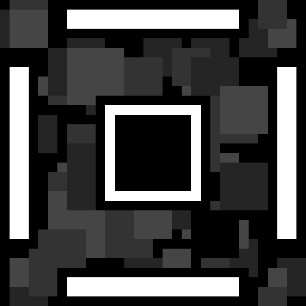

# BrickPong

<p align="center">
  
</p>

<p align="center">
  <strong>A 360° perimeter arcade Pong reimagining built for Android with Java and Canvas</strong>
</p>

<p align="center">
  
  
  
  
  
  
  
</p>

---

## About the Project

> [!NOTE]
> ### Handcrafted in 2016 — Before the AI Era
> 
> This game was developed in **2016** by **Nicola Forasacco**. Every single line of Java code, custom rendering pipeline, multi-threaded game loop (`SurfaceView` + `Runnable`), perimeter collision mathematics, ball deflection physics, and minimalist retro visual styling was **completely crafted by hand**, well before the advent of generative AI, code assistants, or automated workflows. It represents authentic manual mobile indie development from the mid-2010s.
>
> The project has been modernized to **Java 17**, **Android SDK 35** (`compileSdk 35`, `targetSdk 34`), and **Gradle 9.5+** / AndroidX, with legacy third-party advertising SDKs and deprecated services removed, making it clean, self-contained, and publicly accessible to anyone interested in exploring native 2D Android game development from scratch.

---

## Gameplay Overview

**BrickPong** is a fast-paced 360-degree arcade game that reinvents the classic 1972 Pong mechanic. Instead of traditional two-player or single-wall play, the gameplay arena is a square enclosure guarded by **four synchronized paddles** (Top, Bottom, Left, and Right).

The player does not control a single paddle, but rather the entire perimeter defence in tandem:
- Touching or holding **Left** rotates all paddles counter-clockwise along the perimeter.
- Touching or holding **Right** rotates all paddles clockwise along the perimeter.
- Paddles seamlessly wrap around screen edges and corners using real-time split-clipping geometry.
- The ball accelerates exponentially after every bounce (`1.08×` speed multiplier).
- Paddle maximum speed scales dynamically alongside the ball to keep the action fast and intense.
- Dynamic rebound angles depend on the paddle's movement and velocity upon impact.
- Floating ambient background balls drift throughout the arena to create a retro arcade ambiance.
- Points accrue continuously based on ball speed, with high scores saved persistently.

### Key Features

- **360° Perimeter Defense:** A unique circular/perimeter spin on Pong where all four sides of the screen form an active playfield.
- **Synchronized Tandem Controls:** Intuitive two-button directional inputs that control all four paddles in unison.
- **Seamless Corner Wrapping:** Smart dual-rectangle clipping renders paddles smoothly as they transition across screen corners and borders.
- **Dynamic Physics & Speed Scaling:** Ball velocity, paddle speeds, and bounce angles adapt in real-time, escalating difficulty with every successful rally.
- **Pure Native Game Loop:** Built without third-party game engines, utilizing a dedicated background worker thread with `SurfaceView`, `SurfaceHolder`, and hardware-accelerated `Canvas` rendering.
- **Retro Monochrome Aesthetic:** High-contrast black-and-white minimalist visuals accompanied by custom arcade typography (`Chava-Regular.otf`).
- **Persistent Local Records:** High score tracking stored offline via Android `SharedPreferences`.

---

## Paddle and Game Mechanics

| Component | Behavior & Mechanics |
| :--- | :--- |
| **Top Paddle (`PaddleTop`)** | Horizontal paddle guarding the upper boundary. Moves along the X-axis and wraps from right-to-left or left-to-right. |
| **Bottom Paddle (`PaddleBottom`)** | Horizontal paddle guarding the lower boundary. Synchronized in inverse coordinate alignment to maintain perimeter flow. |
| **Left Paddle (`PaddleLeft`)** | Vertical paddle guarding the left boundary. Moves along the Y-axis and wraps vertically across screen height. |
| **Right Paddle (`PaddleRight`)** | Vertical paddle guarding the right boundary. Completes the 4-sided enclosure. |
| **Game Ball (`Ball`)** | Central active projectile. Trajectory calculates custom rebounds taking paddle velocity into account; scales speed by 1.08× on each hit. |
| **Ambient Particles (`backgroundBalls`)** | 9 floating background balls that bounce off borders with randomized velocities and subtle dark gray tones to add visual depth. |
| **Scoring Engine** | Continuous scoring system driven by ball velocity over time (`ball.getASpeed(fps)`). Updates the HUD in real-time. |

---

## Controls

### Android Touch Controls
| Action | Input |
| :--- | :--- |
| **Rotate Counter-Clockwise / Left** | Press & hold on-screen **Left Arrow** button |
| **Rotate Clockwise / Right** | Press & hold on-screen **Right Arrow** button |
| **Stop Paddles** | Release touch |
| **Start / Restart Game** | Tap **Play** button on menu or game over screen |
| **View High Score** | Tap **Trophies** icon to display personal record toast |

---

## Project Structure

```
BrickPong/
|-- app/
|   |-- libs/                        # Local library archives
|   |-- src/main/
|   |   |-- assets/
|   |   |   `-- fonts/
|   |   |       `-- Chava-Regular.otf # Custom retro arcade font
|   |   |-- java/com/brick/brickpong/
|   |   |   |-- Ball.java                    # Ball physics, bounce reflections, speed ramping
|   |   |   |-- Game.java                    # Arena dimensions, scoring state, canvas clear
|   |   |   |-- GameView.java                # Dedicated game loop thread, Canvas render pipeline, collision logic
|   |   |   |-- MainActivity.java            # Main activity, UI states (Menu, Game, GameOver), touch listeners
|   |   |   |-- Paddle.java                  # Base paddle class (dimensions, speed, movement vectors)
|   |   |   |-- PaddleBottom.java            # Lower boundary paddle implementation
|   |   |   |-- PaddleLeft.java              # Left boundary paddle implementation
|   |   |   |-- PaddleRight.java             # Right boundary paddle implementation
|   |   |   |-- PaddleTop.java               # Upper boundary paddle implementation
|   |   |   |-- SharedPreferencesManager.java# Persistent high score storage
|   |   |   |-- SoundPlayer.java             # Sound playback handler
|   |   |   `-- SplashScreen.java            # Animated splash intro screen
|   |   |-- res/                             # Layouts, drawables, fonts, and XML resources
|   |   |   |-- drawable/                    # Icons and vector/PNG assets
|   |   |   |-- layout/                      # UI layouts (activity_main.xml, splash_screen.xml)
|   |   |   `-- values/                      # Strings, colors, styles, dimensions
|   |   `-- AndroidManifest.xml              # App manifest & permissions
|   `-- build.gradle                         # App module build configuration (SDK 35, Java 17)
|-- gradle/wrapper/                          # Gradle wrapper files
|-- build.gradle                             # Root build configuration
|-- gradle.properties                        # JVM and build properties
`-- settings.gradle                          # Module definitions
```

---

## Getting Started

### Prerequisites
- **Android Studio** (Ladybug / Jellyfish or newer recommended).
- **JDK 17** (configured as Gradle JDK in Android Studio).
- **Android SDK:** Platform 35 (`compileSdk 35`, `targetSdk 34`, `minSdk 21`).
- Physical Android device or Android Virtual Device (AVD) running Android 5.0 (API 21) or higher.

### Installation and Setup
1. Clone the repository:
   ```bash
   git clone https://github.com/NicolaForasacco/BrickPong.git
   ```
2. Open **Android Studio**.
3. Select **Open** and choose the cloned `BrickPong` directory.
4. Allow Gradle to sync dependencies and index the project.
5. Connect an Android device with USB Debugging enabled, or launch an Android Virtual Device (AVD).
6. Click **Run** (`Shift + F10`) or assemble the APK via **Build > Build Bundle(s) / APK(s) > Build APK(s)**.

---

## Credits and Author

- **Game Design, Programming, and Art:** [Nicola Forasacco](https://github.com/NicolaForasacco) (@brick)
- **Original Development Period:** 2016
- **Project Name:** BrickPong

---

## License

This project is released under a **Custom Non-Commercial and Educational License**.

- **Source Code:** Free to inspect, study, compile, and learn from for personal, educational, and portfolio purposes.
- **Prohibition of Store Publishing and Monetization:** You may not repackage, re-skin, monetize, or publish this game (or works derived from it) to any app store or platform (including Google Play, App Store, itch.io, or web portals), nor monetize it through advertisements, in-app purchases, or paid distribution.
- **Game Assets and Art:** All original visual elements, font selections, branding, and game concepts remain the exclusive intellectual property of Nicola Forasacco. Reusing, extracting, or redistributing these assets in other projects is not permitted.

See the [LICENSE](LICENSE) file for the complete terms and legal details.
